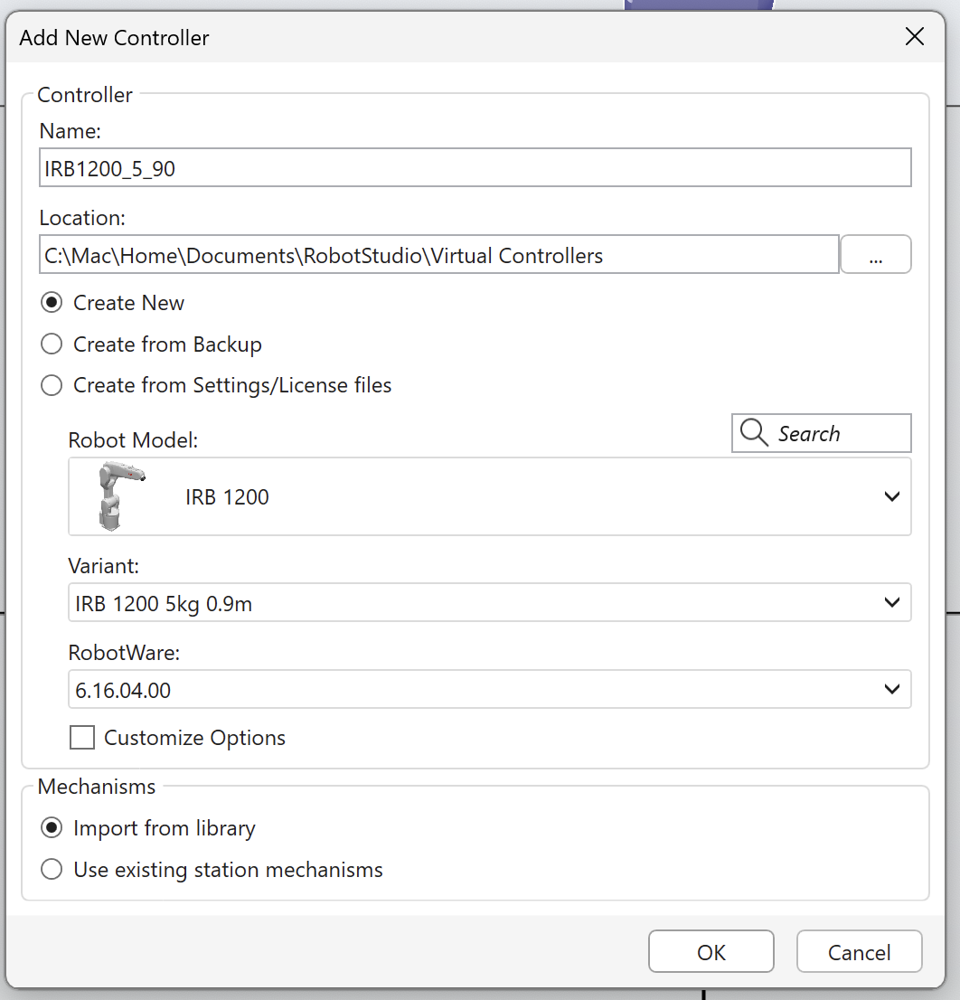
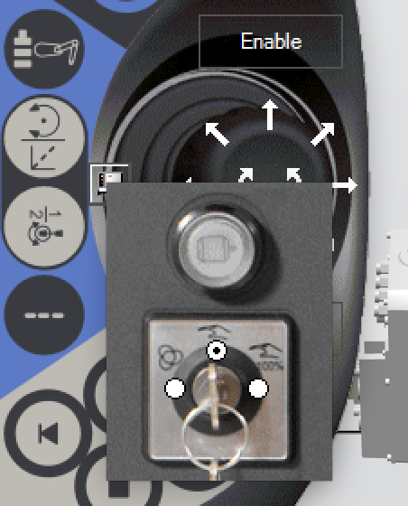
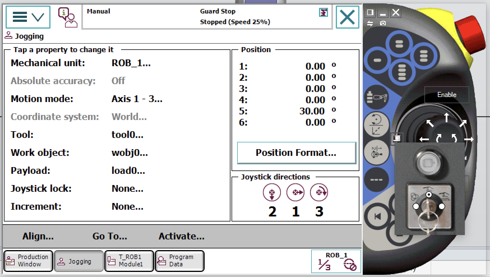

# Taller de Pick & Place con garra: preparar RobotStudio

[← Volver al taller](README.md)

Taller **Mechanica Movet Mundum**, Escuela de Mecánica, UTEM (Santiago de Chile), noviembre de 2026.
Prof. Dr. Julio Cesar Frantz (UNIFEBE, Brasil).

En el taller hay una **estación de simulación**: el mismo robot de la Escuela, un ABB
**IRB 1200-7/0.7** (7 kg de carga, 0,7 m de alcance), en el computador. Para no perder esos 30 minutos instalando, **cada equipo llega con un laptop listo**.
Esta página explica cómo dejarlo listo en casa.

> **La meta:** llegar al taller con un IRB 1200 virtual que se mueve con el joystick del
> FlexPendant virtual. Si al final de esta página ven **Motors On**, están listos.

## Qué necesitan

- **Un laptop con Windows 10 u 11 (64 bits) por equipo.** RobotStudio no existe para Mac ni Linux.
  En una Mac solo funciona dentro de una máquina virtual con Windows (Parallels): es posible, pero
  lleva mucho más tiempo. Mejor que el equipo use un laptop con Windows.
- **Permiso de administrador** para instalar programas. Los laptops de empresa a veces lo bloquean:
  pruébenlo antes.
- **Varios GB libres** en el disco y una conexión buena: la descarga es grande.
- **Una cuenta ABB** (gratuita), para descargar el RobotWare en el paso 2.
- **Un mouse.** Con el touchpad el joystick virtual es muy difícil.
- Entre **30 y 60 minutos**, casi todo esperando la descarga.

**Cuándo:** una o dos dias antes del taller. No antes de eso: si activan la prueba de 30 días,
que no venza antes del taller. Si vence, RobotStudio sigue funcionando en la versión básica
(gratuita), que alcanza para todo lo que hacemos.

## Paso 1: instalar RobotStudio

1. Entrar en la página de RobotStudio de ABB:
   <https://new.abb.com/products/robotics/robotstudio/robotstudio-desktop>
2. **Bajar la página hasta casi el final**, hasta el bloque **GET YOUR ROBOTSTUDIO® LICENSE**
   (*"Click below to request a premium license or test RobotStudio Cloud or Desktop for 30
   days"*). Ahí hay tres opciones: *Premium*, *RobotStudio® Cloud* y *RobotStudio® Desktop*.
3. Clic en **RobotStudio® Desktop** (no *Cloud*): es la **prueba gratuita de 30 días**. Hacer el
   **registro gratuito** que aparece y, al terminarlo, descargar el instalador.
4. Descomprimir y ejecutar el `setup.exe`. Aceptar las opciones que vienen marcadas.
5. Abrir RobotStudio. Si pregunta por la licencia, elegir la **prueba** (*trial*).

## Paso 2: instalar el RobotWare 6 (el del controlador IRC5)

El **RobotWare** es el software que corre dentro del controlador del robot. El robot de la UTEM
tiene un controlador **IRC5**, que usa **RobotWare 6**. Las versiones nuevas de RobotStudio no lo
traen instalado.

1. Arriba a la derecha, **Log In** con la cuenta ABB.
2. Pestaña **Add-Ins** > **Gallery**.
3. Buscar `RobotWare` e instalar un **RobotWare 6.x** (en las pruebas usamos el **6.16.04.00**).

> ⚠️ **No usen el RobotWare 7.x.** Es del controlador nuevo de ABB (OmniCore), que tiene otro
> FlexPendant. Con el 7.x el robot virtual ya no se parece al de la UTEM.

## Paso 3: crear el IRB 1200 virtual

1. **File > New > Station > Create** (una estación vacía).
2. **Home > Virtual Controller > New Controller...** Dejar **Create New** marcado y llenar:

   | Campo | Valor |
   |---|---|
   | Name | `TallerUTEM` |
   | Robot Model | **IRB 1200** |
   | Variant | **`IRB 1200 7kg 0.7m`** (el de la UTEM) |
   | RobotWare | **6.x** (la que instalaron en el paso 2) |

3. **OK.** Esperar 1 a 2 minutos, hasta que el indicador de abajo a la derecha quede **verde**.
4. **File > Save As** > `TallerUTEM`. Esta es la estación que van a abrir en el taller.

> En esta imagen la variante es `5kg 0.9m`. Ustedes elijan **`7kg 0.7m`**, la del robot de la UTEM.

Mover la vista 3D: rueda del mouse = zoom · **Ctrl + Shift + clic izquierdo** = girar ·
**Ctrl + clic izquierdo** = desplazar.

## Paso 4: el FlexPendant virtual en Manual

El **FlexPendant** es el control de mano del robot. El virtual es igual al real.

1. **Controller > FlexPendant** (o **Ctrl + F5**).
2. **El controlador virtual arranca en automático**, y así el joystick no mueve nada. Abrir el
   **Control Panel**: es el **ícono pequeño a la izquierda del joystick** (no está en la cinta de
   arriba). Girar la llave a **Manual**, la posición del medio.
3. Clic en **Enable** (el dispositivo de habilitación virtual): queda presionado. Arriba del
   FlexPendant tiene que decir **Motors On** (no *Guard Stop*).

> La llave virtual tiene 3 posiciones. La del robot de la UTEM tiene 2: automático y manual.

## Paso 5: mover el robot

1. Menú **ABB** (arriba a la izquierda) > **Jogging**.
2. **Increment: None** y **Motion mode: Axis 1-3**.
3. **Clic y arrastrar** sobre el joystick del FlexPendant virtual: el robot se mueve.
4. Probar **Axis 4-6** y **Linear**. ¿Qué cambia?

## Paso 6: crear las dos salidas de la garra (recomendado)

El robot de la UTEM abre y cierra la garra con dos salidas digitales, `ES_S01` (abre) y `ES_S02`
(cierra). El robot virtual no las tiene: se crean como **salidas virtuales**. Si lo hacen en casa,
en el taller ganan 5 minutos.

1. Pestaña **Controller** > **Configuration** > **I/O System**.
2. En la lista de tipos, clic derecho en **Signal** > **New Signal...**
3. **Name:** `ES_S01` · **Type of Signal:** **Digital Output** · **Assigned to Device:** dejar
   **vacío**. **OK**.
4. Repetir para `ES_S02` (con **cero**: ese, cero, dos).
5. RobotStudio pide reiniciar: **Controller > Restart > Restart (Warmstart)**.
6. En el FlexPendant virtual: **ABB > Inputs and Outputs > View > Digital Outputs**. Tienen que
   aparecer `ES_S01` y `ES_S02`, las dos en **0**.
7. **File > Save**.

## ✅ ¿Están listos?

- [ ] RobotStudio abre sin errores.
- [ ] La estación `TallerUTEM` está guardada, con un **IRB 1200 7kg 0.7m** y **RobotWare 6.x**.
- [ ] Arriba del FlexPendant dice **Manual** y **Motors On**.
- [ ] El robot se mueve con el joystick.
- [ ] (Recomendado) `ES_S01` y `ES_S02` aparecen en Digital Outputs.

Si marcaron los cuatro primeros, listo. El día del taller: **laptop cargado, cargador y mouse.**

## Si algo no funciona

| Síntoma | Causa probable | Solución |
|---|---|---|
| No aparece RobotWare 6.x en *New Controller* | Falta instalarlo | Paso 2: Add-Ins > Gallery, con la sesión ABB iniciada |
| La Gallery está vacía o no deja instalar | Sesión ABB cerrada | **Log In** arriba a la derecha y abrir la Gallery otra vez |
| El instalador no arranca o pide contraseña | Laptop sin permiso de administrador | Usar otro laptop del equipo |
| El joystick no mueve el robot | Controlador en **automático** | Control Panel (ícono junto al joystick) > **Manual** |
| Arriba dice *Guard Stop* | Enable sin presionar | Clic en **Enable** |
| *"Waiting for motors on after emergency stop"* | Se presionó la parada de emergencia | Otro clic en la parada para soltarla; Control Panel > **Reset Emergency Stop** > **Motors On** |
| El robot casi no se mueve | Increment activado | Jogging > Increment > **None** |
| El joystick es difícil de usar | Touchpad | Usar un mouse. O: panel **Layout** > clic derecho en el robot > **Mechanism Joint Jog** (una barra por eje) |
| Aviso *"No active license"* | La prueba venció o no se activó | No pasa nada: la versión básica alcanza para el taller |

Si no lo logran, igual vengan: en el taller hay un pendrive con los instaladores y se resuelve ahí.
Pero la instalación lleva tiempo, así que lo mejor es llegar con el laptop listo.

## En el taller

En la estación de simulación ustedes van a **abrir la estación `TallerUTEM`** y hacer en el
FlexPendant virtual el mismo programa de pick & place con garra que hacen en el robot real: cinco
puntos, `MoveJ` y `MoveL`, y la garra con `Set`, `Reset` y `WaitTime`. Todo eso está en el cuaderno impreso del taller. No hace falta
practicar antes; solo instalar.

## Después del taller

[`PickGarraBasico.mod`](nivel-basico/rapid/PickGarraBasico.mod) es el programa completo del
taller, para comparar con el de su equipo. Para cargarlo: pestaña **RAPID** > controlador > **T_ROB1** > clic derecho > **Load
Module...**

---

RobotStudio, RobotWare, FlexPendant e IRC5 son marcas de ABB. Este es material de un taller
académico; no es un tutorial oficial de ABB. Texto bajo licencia
[CC BY-NC-SA 4.0](LICENSE), © 2026 Julio Cesar Frantz (UNIFEBE).
